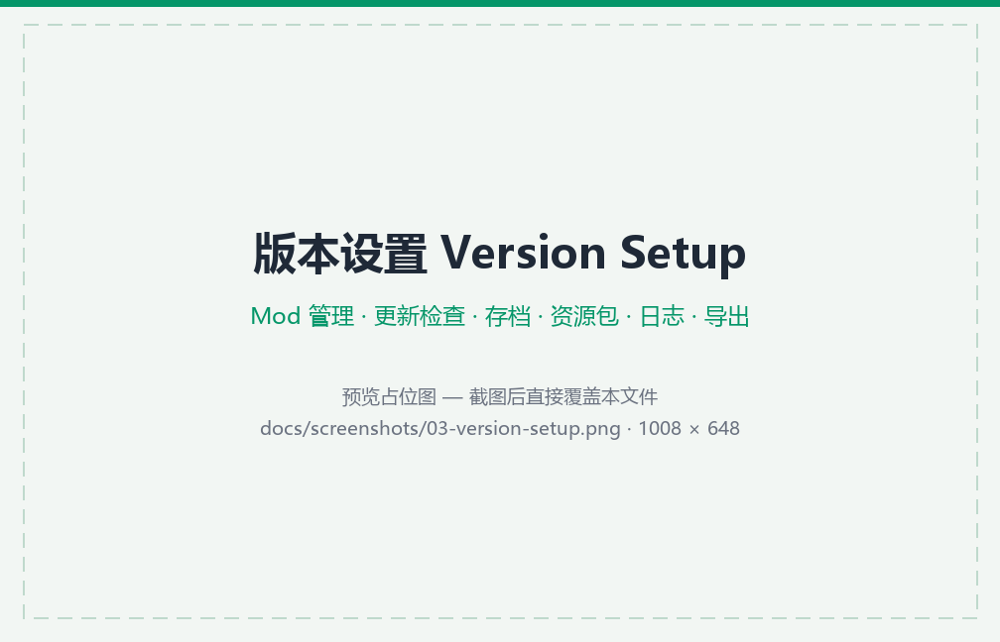

<div align="center">


# Elytra Launcher

### 🪽 展开鞘翅，即刻起飞

—— 下载、整合、联机，一步到位

<sub>🪟 Windows · 🐧 Linux · 🍎 macOS &nbsp;|&nbsp; 由 Tauri v2 与 Vue 3 驱动</sub>

<sub>**免费** · **开源** · **跨平台**</sub>

[](https://github.com/nefelibetas/Elytra/releases)
[](LICENSE)
[](https://github.com/nefelibetas/Elytra)

**简体中文** · [English](README-en-US.md)

</div>

---

## 🖼️ 预览

<p align="center">
  
  <br /><sub><b>启动页</b> · 版本卡片与一键启动</sub>
</p>

<p align="center">
  
  <br /><sub><b>资源中心</b> · Mod / 整合包 / 资源包 / 光影 / 数据包 / 地图 搜索与安装</sub>
</p>

<p align="center">
  
  <br /><sub><b>版本设置</b> · Mod 管理与更新检查</sub>
</p>

<p align="center">
  
  <br /><sub><b>皮肤衣柜</b> · 3D 全身预览与皮肤 / 披风管理</sub>
</p>

<p align="center">
  
  <br /><sub><b>皮肤绘画器</b> · 展开图逐像素 + 3D 直绘</sub>
</p>

<p align="center">
  
  <br /><sub><b>局域网联机</b> · 房间码互连</sub>
</p>

## ✨ 功能

### 📦 下载与安装

- 🎮 **游戏版本**：官方源 / 国内镜像多源回退（自动 · 仅官方 · 仅镜像三态），sha1 校验，并发下载与限速
- 🧩 **ModLoader**：Fabric / Quilt / Forge / NeoForge / OptiFine 一键安装（新老版本皆可）
- 🧰 **缺失文件修复**：扫描版本安装完整性并一键补齐
- ☕ **JDK 管理**：本机 JDK 扫描 + managed runtime 自动下载（Mojang → Azul 双源回退）
- 📥 **内容下载**：Mod / 整合包 / 数据包 / 资源包 / 光影包 / 地图存档在线搜索与安装（Modrinth · CurseForge 双源），整合包支持本地导入（`.mrpack` / `.zip`）
- 🕸️ **Mod 依赖解析**：安装前展示依赖链，逐项一键装入对应版本

### 🗂️ 内容管理

- ⚙️ **版本设置**：Mod 管理（更新检查 · 批量启停）、存档、资源包、光影包、数据包、服务器列表、图标、游戏日志
- 📤 **导出**：启动脚本（`.bat` / `.sh`）与整合包（MRPACK）
- 📁 **多游戏目录**：多份游戏目录独立管理、随时切换
- 🤖 **自动任务**：启动前 / 退出后自动执行存档备份（保留 N 份）、Mod 清单记录、崩溃日志打包（含脱敏），支持全局与逐实例配置
- 👀 **目录监听**：版本与资源目录变化自动刷新

### 🔐 账号与外观

- 🔐 **账号**：微软正版登录（OAuth PKCE，多账号）、离线模式、第三方皮肤站（Yggdrasil 兼容：LittleSkin / 自建站）
- 🎭 **皮肤衣柜**：3D 全身预览、官方皮肤 / 披风切换与皮肤上传、本地皮肤收藏
- 🎨 **皮肤绘画器**：64×64 逐像素展开图 + **3D 直绘**双模式，画笔 / 橡皮 / 油漆桶 / 吸管、自由缩放平移、每部位独立配色标注、内层 / 外层图层、撤销重做，实时 3D 预览

### 🌐 联机与工具箱

- 🌐 **局域网联机**：EasyTier 虚拟局域网内嵌（房间码互连，无需公网服务器），跨网可配协调服务器
- 🚀 **多线程下载器**：URL 队列并发 + 单文件 HTTP Range 分段，支持断点续传
- 📡 **服务器状态**：Java 版 SLP 与基岩版 RakNet 探测（多地址）
- 🧪 **生成器**：MOTD、物品 NBT、生物 NBT、指令（含目标选择器组合），内联烟花 / 药水 / 村民交易编辑器

### 🎛️ 界面

- 🎨 四套内置主题（草方块绿 · 末影紫 · 下界橙 · 冰霜青）+ 自定义主题编辑器
- ⌨️ 全键盘导航与焦点管理、无边框自绘窗口

## 📥 下载与安装

从 [Releases](https://github.com/nefelibetas/Elytra/releases) 下载对应平台的产物：

| 平台 | 产物 | 说明 |
|---|---|---|
| 🪟 Windows | `-setup.exe`（NSIS）· `.msi` · 便携 `.zip` | 安装位置自选（NSIS 默认 `%LOCALAPPDATA%`，MSI 默认 `Program Files`）；zip 解压即用 |
| 🍎 macOS | universal `.dmg` | 需要 macOS 13+；未公证签名，首次打开需 **右键 → 打开** |
| 🐧 Linux | `.AppImage` · `.deb` · `.rpm` · 便携 `.tar.gz` | 构建于 Ubuntu 22.04（glibc 2.35+） |

### 卸载与数据

| 形式 | 卸载方式 | 启动器配置（`Elytra/`） |
|---|---|---|
| 🪟 NSIS 安装版 | 自带卸载器 | 勾选「Delete the application data」删除（默认不删除）；位置 `%APPDATA%\Elytra` |
| 🪟 MSI 安装版 | 自带卸载器 | **不清理**，需手动删除 `%APPDATA%\Elytra` |
| 🪟 便携 zip | 删除解压后文件 | 手动删除 `%APPDATA%\Elytra` |
| 🍎 macOS | 删除 `Elytra Launcher.app` | 手动删除 `~/Library/Application Support/Elytra` |
| 🐧 deb / rpm | 包管理器卸载 | **不清理**，手动删除 `~/.local/share/Elytra` |
| 🐧 AppImage / tar.gz | 删除文件 / 目录 | 手动删除 `~/.local/share/Elytra` |

- Windows 的安装版与便携版**共用同一份配置**（都在 `%APPDATA%\Elytra`）
- **卸载不会删除游戏数据**：安装目录只做非递归删除（目录非空即保留），手动指定的游戏目录更不在清理范围内

## 🚀 快速开始

1. **准备游戏目录** — 版本、Mod 与存档均存放于游戏目录（`.minecraft`）。Windows 安装版默认位于启动器目录旁；若为空（MSI 安装至只读的 `Program Files`、macOS、Linux），请在「版本选择」页选择「添加已有游戏目录」
2. **下载游戏** — 进入「资源中心 → 原版游戏」选择版本；展开详情可同时添加 ModLoader（Fabric / Quilt / Forge / NeoForge / OptiFine），点击「开始下载」，下载进度可在「任务中心」查看
3. **登录（可选）** — 启动页顶部可切换「正版 / 离线 / 第三方」；离线模式使用固定随机 Steve/Alex 皮肤，支持单机游玩
4. **启动游戏** — 在启动页选中版本并点击「启动」。若提示未找到 Java，请前往「设置 → 启动设置 → Java 运行时」扫描本机 JDK，或点击「下载缺失 JDK」自动安装

> Mod、整合包、资源包、光影与地图存档均可在「资源中心」搜索安装；「工具箱」提供局域网联机、服务器状态、NBT / 指令生成器、皮肤绘画器与多线程下载器。

## 🛠️ 开发

> 工具链版本以 `mise.toml` 为唯一来源（node / pnpm / rust / protoc）；编译联机功能（EasyTier）另需 libclang（LLVM）。包管理器必须使用 pnpm。

```bash
mise install          # 按 mise.toml 安装工具链
pnpm install          # 安装前端依赖
pnpm tauri dev        # 开发模式：vite :1420 + Rust dev 窗口（Rust 改动需重启）
pnpm build            # 前端类型检查 + CSS 兼容性检查 + 构建

cd src-tauri
cargo check                                        # Rust 编译检查
cargo clippy --lib                                 # Rust lint（保持零警告）
cargo test --lib -- --test-threads=1               # 单元测试（须串行）
cargo test --test online_diag                      # 联机集成测试（双实例回环）
cargo test --test tool_download                    # 工具箱下载器集成测试（本地 HTTP 服务驱动）
```

> ℹ️ 少数网络测试（`fetch_asset_index_end_to_end`、`count_assets_all_end_to_end`、`global_client_uses_system_proxy_when_enabled`）走真实外网单发小请求，离线环境会失败或跳过；`bmclapi_optifine_real_download` 标了 `#[ignore]` 默认不跑。

## 📁 结构

### 🖼️ 前端 `src/`

- **`pages/`** — 10 个页面（启动 / 资源中心 / 任务中心 / 设置 / 工具 / 版本选择 / 版本设置 / 资源详情 / 皮肤衣柜 / 主题编辑器）
- **`component/`** — 组件按域分组（`common/` `download/` `launch/` `settings/` `tools/` `version/` `version-setup/`）
- **`store/`** — 模块级 `reactive()` 状态单例，按域分包（`app/` `config/` `task/` `auth/` `community/` `skin/`）
- **`utils/`** — 纯函数工具（格式化 / 键盘焦点 / toast 等）
- **`types/`** — 由 Rust 自动生成的 TS 类型（勿手改）

### 🦀 后端 `src-tauri/src/`

- **`commands/`** — 命令胶水层：134 个 `#[tauri::command]`，只做参数展平与领域调用
- **`downloader/`** — 纯传输层：多源 fetch / 并发批处理 / 源探测 / 分段下载 / 路径互斥
- **`game/`** — 内容与装配：版本元数据 / 资源 / ModLoader 安装 / 社区资源 / 整合包 / Mod 更新
- **`task/`** — 任务编排与事件派发、SQLite 快照与崩溃恢复
- **`tooldl/`** — 工具箱多线程下载器
- **`launcher/`** — 启动参数构建 / 环境准备 / 进程生命周期 / 自动任务
- **`auth/`** — 微软 OAuth / 官方 API / 第三方皮肤站
- **`jdk/`** — 本机 JDK 扫描与 managed runtime 下载
- **`online/`** — EasyTier 局域网联机
- **`persist/`** — TOML 配置与密钥存储
- **`util/`** — 跨域纯函数

### 📚 其它

- **`docs/`** — 图标与预览图
- **`AGENTS.md`** — 架构分层与编码约定
- **`LICENSE`** — GPL-3.0

依赖方向：`commands` → 领域层（`game/` `task/` `launcher/` …）→ `downloader/`（纯传输层，不依赖任何上层）。

详见 📖 [AGENTS.md](AGENTS.md)（仓库开发指南）。

## 💻 运行时

- 🪟 Windows · 🐧 Linux · 🍎 macOS 13+（窗口 1008×648、无边框透明、不可缩放）
- ⚙️ 配置目录（`Settings.toml` / `secrets.bin` / `tasks.db` / 日志）：
  - Windows：`%APPDATA%\Elytra`
  - macOS：`~/Library/Application Support/Elytra`
  - Linux：`$XDG_DATA_HOME/Elytra`（缺省 `~/.local/share/Elytra`）
- 📁 游戏目录：Windows 默认为启动器目录旁（便携，整目录拷走即迁移）；安装目录只读（如 MSI 装到 `Program Files`）或 macOS / Linux 时需手动指定
- 🧪 开发与测试进程的配置在 exe 旁 `Elytra/`，与正式安装隔离

## 🤝 贡献与反馈

- **问题反馈**：请在 [Issues](https://github.com/nefelibetas/Elytra/issues) 提交，并附启动器日志（「设置 → 启动器日志」可打开所在目录）、启动器版本号与复现步骤
- **代码贡献**：请先阅读 [CONTRIBUTING.md](CONTRIBUTING.md)——开发环境、提交前必过的检查、分支与提交规范都写在那里
- 架构分层与编码约定详见 [AGENTS.md](AGENTS.md)

## 🙏 致谢

- [Tauri](https://tauri.app/) · [Vue 3](https://vuejs.org/) · [Vite](https://vite.dev/) — 应用框架与工具链
- [EasyTier](https://github.com/EasyTier/EasyTier) — 局域网联机的虚拟网络层
- [Lucide](https://lucide.dev/) — 图标
- [BMCLAPI](https://bmclapi2.bangbang93.com/) — 国内下载镜像
- [MCIM](https://mod.mcimirror.top/) — Modrinth / CurseForge 镜像与翻译数据
- [Modrinth](https://modrinth.com/) · [CurseForge](https://www.curseforge.com/minecraft) · [MC 百科](https://www.mcmod.cn/) — 社区资源与条目数据
- [Mojang](https://www.minecraft.net/) · [Azul](https://www.azul.com/downloads/) — 游戏元数据与 JDK runtime
- Fabric · Quilt · Forge · NeoForge — 各 ModLoader 的 Maven 元数据
- [HMCL](https://github.com/HMCL-dev/HMCL) — 同类开源启动器，本项目 GPL-3.0 许可证与之对齐
- [PCL2](https://github.com/Meloong-Git/PCL) — 界面布局设计参考；中文内容搜索内嵌其 `WikiEntries.txt` 快照（见[第三方声明](THIRD-PARTY-NOTICES.md)）

## ⚖️ 免责声明

Elytra 是第三方开源项目，与 Mojang Studios / Microsoft 无任何关联，亦未获其授权或认可。
「Minecraft」及相关名称、商标归 Mojang Studios 所有。
本项目仅提供游戏内容的下载与管理工具，**不包含任何游戏本体文件**。

## 📄 许可证

基于 [GPL-3.0](LICENSE) 许可证开源。

随仓库分发的第三方内容与数据（PCL WikiEntries 快照、ModLoader 图标、Minecraft 素材）另行声明，见 [THIRD-PARTY-NOTICES.md](THIRD-PARTY-NOTICES.md)。
